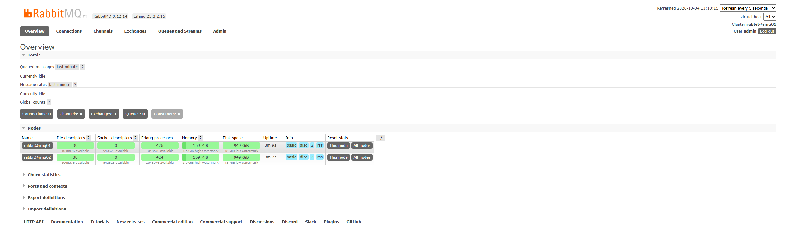
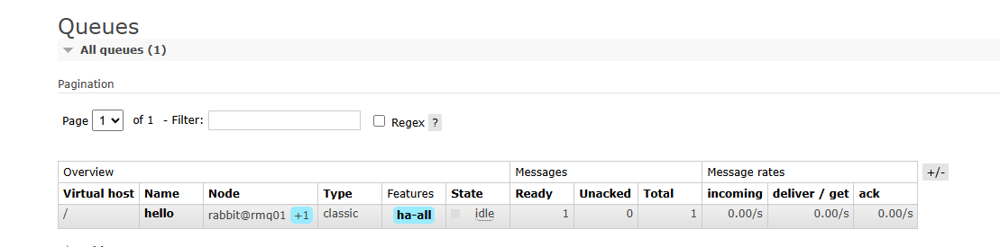
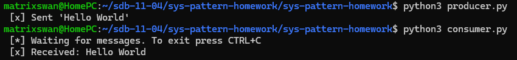
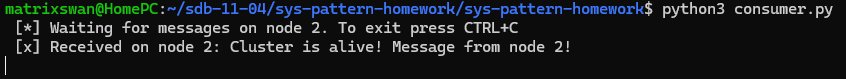

# Домашнее задание к занятию «Очереди RabbitMQ» - Сидоренко Алексей

---

### Задание 1. Установка RabbitMQ

Созданы две ноды RabbitMQ с включенным management plug-in.

**Этапы выполнения:**
1. Создан `docker-compose.yml` с двумя сервисами: `rmq01` и `rmq02` (образ `rabbitmq:3.12-management`).
2. Для обеих нод установлен одинаковый `RABBITMQ_ERLANG_COOKIE` для возможности объединения в кластер.
3. Контейнеры запущены, веб-интерфейс доступен по портам 15672 и 15673.

**Скриншот:**

---

### Задание 2. Отправка и получение сообщений

Проведена тестовая отправка и получение сообщения с помощью скриптов на Python (библиотека `pika`).

**Этапы выполнения:**
1. Установлена библиотека `pika`.
2. Написаны скрипты `producer.py` (отправка) и `consumer.py` (получение) с авторизацией под пользователем `admin`.
3. Сообщение успешно отправлено в очередь `hello` и получено потребителем.

**Скриншоты:**

---

### Задание 3. Подготовка HA кластера

Две ноды объединены в кластер, настроена политика высокой доступности (High Availability).

**Этапы выполнения:**
1. Ноде `rmq02` выполнен `reset` и `join_cluster rabbit@rmq01`.
2. Создана политика `ha-all` с паттерном `.*` и параметром `{"ha-mode":"all"}`, чтобы все очереди зеркалировались на все узлы.
3. Протестирована отказоустойчивость: первая нода (`rmq01`) была остановлена. Скрипт `consumer.py` был перенастроен на порт второй ноды (5673) и успешно получил сообщение, подтверждая работу кластера при сбое одного из узлов.

**Скриншоты:**

